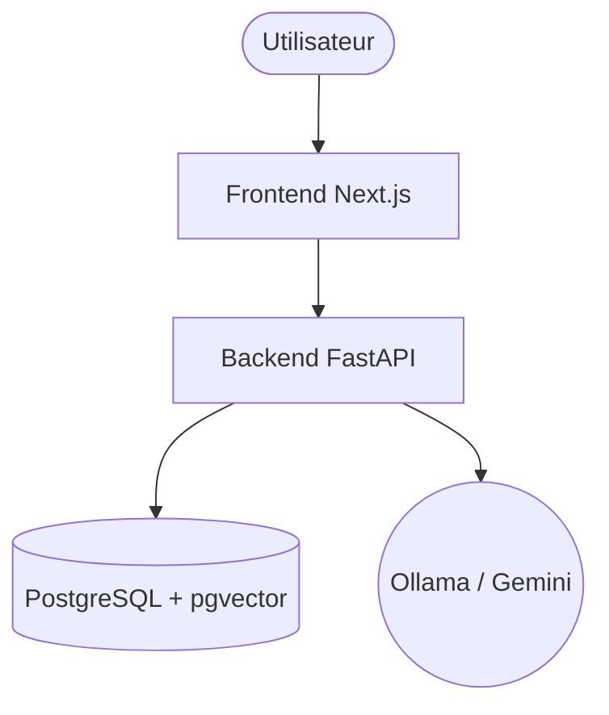

# Camrail - RailMind Lite

Bienvenue dans le dépôt du projet **RailMind Lite** développé pour CAMRAIL. Il s'agit d'un système de Retrieval-Augmented Generation (RAG) complet permettant l'interrogation intelligente du corpus documentaire de CAMRAIL (procédures, sécurité, manuels, etc.).

## Architecture du Projet

Le dépôt est structuré en deux parties principales :

1. **[Backend (FastAPI)](backend/)**
   - **Rôle :** Moteur RAG, ingestion documentaire, base de données vectorielle (pgvector) et génération de réponses (Ollama en local ou Gemini en ligne).
   - **Stack :** Python 3.12+, FastAPI, SQLAlchemy, pgvector.
   - **Sécurité :** Contrôle d'accès basé sur les rôles (RBAC) et filtrage par département.

2. **[Frontend (Next.js)](frontend/camrail-rda/)**
   - **Rôle :** Interface utilisateur moderne pour interagir avec l'assistant, visualiser les documents et gérer les requêtes.
   - **Stack :** Next.js (App Router), React, TailwindCSS.



## Démarrage Rapide

### 1. Démarrer le Backend
Consultez le [**README du backend**](backend/README.md) pour les instructions détaillées d'installation, la configuration de la base de données et de l'environnement de démo.

```bash
cd backend
cp env.example .env
pip install -r requirements.txt
alembic upgrade head
python seed_demo.py
uvicorn app.main:app --reload
```

### 2. Démarrer le Frontend
Consultez le [**README du frontend**](frontend/camrail-rda/README.md) pour les détails.

```bash
cd frontend/camrail-rda
npm install
npm run dev
```

L'application sera accessible sur [http://localhost:3000](http://localhost:3000).

## Fonctionnalités Principales
- **Recherche Hybride** : Sémantique (vectorielle) et Lexicale.
- **Sécurité et Droits d'Accès** : Les résultats sont filtrés selon les droits et le département de l'utilisateur.
- **Génération Augmentée (RAG)** : Des réponses précises avec citations et gestion de la confiance (fallback si hors-sujet).
- **Fallback OCR** : Traitement automatique des PDF scannés.
