# 🚆 CAMRAIL — RailMind Lite
### Moteur RAG Documentaire Souverain, Local et Sécurisé

[](backend/)
[](backend/)
[](frontend/camrail-rda/)
[](frontend/camrail-rda/)
[](deploy/postgres/)
[](https://ollama.com)
[](#-confidentialit%C3%A9-et-souverainet%C3%A9-100-locale)
[](SECURITY.md)

**CAMRAIL RailMind Lite** est le système de recherche documentaire augmentée par génération (**RAG — Retrieval-Augmented Generation**) conçu sur mesure pour les besoins d'exploitation ferroviaire de **CAMRAIL** (Cameroun).

Il permet aux agents, conducteurs, techniciens de maintenance et cadres d'interroger instantanément et en langage naturel l'ensemble du corpus réglementaire de l'entreprise (manuels d'exploitation, consignes de sécurité, fiches de dépannage, réglementation de la traction, accords d'entreprise), avec **citations de sources exactes, preuves textuelles surlignées et zéro fuite de données**.

---

## 📑 Sommaire
1. [Vue d'Ensemble & Architecture](#-vue-densemble--architecture)
2. [Confidentialité et Souveraineté 100% Locale](#-confidentialit%C3%A9-et-souverainet%C3%A9-100-locale)
3. [Pipelines Techniques Détaillés](#-pipelines-techniques-d%C3%A9taill%C3%A9s)
   - [Pipeline d'Ingestion Documentaire (PDF & DOCX)](#a-pipeline-dingestion-documentaire-pdf--docx)
   - [Pipeline de Requête RAG & Extraction de Preuves](#b-pipeline-de-requ%C3%AAte-rag--extraction-de-preuves)
4. [Modèles d'IA & Inférence Locale](#-mod%C3%A8les-dia--inf%C3%A9rence-locale)
5. [Fonctionnalités de l'Interface Utilisateur](#-fonctionnalit%C3%A9s-de-linterface-utilisateur)
6. [Scalabilité, Résilience & Haute Concurrence](#-scalabilit%C3%A9-r%C3%A9silience--haute-concurrence)
7. [Sécurité Industrielle & Modèle de Menaces](#-s%C3%A9curit%C3%A9-industrielle--mod%C3%A8le-de-menaces)
8. [Guide de Démarrage Rapide](#-guide-de-d%C3%A9marrage-rapide)
9. [Inventaire des Scripts Utilitaires](#-inventaire-des-scripts-utilitaires)
10. [Documentation Associée](#-documentation-associ%C3%A9e)

---

## 🏛️ Vue d'Ensemble & Architecture

Le système s'articule autour d'une architecture à trois niveaux, entièrement déployable sur site (*on-premise*) ou en environnement conteneurisé durci :



1. **Frontend Web (Next.js 16 / React 19 / TailwindCSS v4)** :  
   Interface utilisateur réactive offrant un assistant conversationnel temps réel avec streaming de tokens, visualiseur de documents PDF/DOCX avec défilement dynamique vers le passage cité, gestion d'historique et support bilingue FR/EN.
2. **Backend API & Moteur RAG (FastAPI / Python 3.12+)** :  
   API REST haute performance assurant le contrôle d'accès strict (RBAC), la segmentation documentaire, la recherche hybride dense/lexicale avec fusion RRF, la régulation de charge et le scellement cryptographique du journal d'audit.
3. **Zone Données & Inférence Souveraine** :  
   - **PostgreSQL 16 + pgvector** : Stockage relationnel et index vectoriels HNSW accélérant les recherches de similarité cosinus sub-milliseconde.
   - **Ollama Engine** : Serveur d'inférence LLM local exécutant les modèles de langage sans aucune connexion cloud.

---

## 🔒 Confidentialité et Souveraineté 100% Locale

Conformément aux directives de sécurité industrielle de CAMRAIL :
* **Zéro Appel Cloud Externe** : Aucun appel vers des API tierces (OpenAI, Google Gemini, Anthropic ou Hugging Face) en production.
* **Circuit Fermé Strict (Air-Gapped)** : Le système fonctionne en autonomie complète hors d'Internet (`HF_HUB_OFFLINE=1`, `TRANSFORMERS_OFFLINE=1`). Vérifié automatiquement par des tests unitaires sous interception réseau stricte (`tests/test_no_outbound_network.py`).
* **Poids des Modèles Embarqués Localement** : Tous les poids (vecteurs d'embeddings et modèles LLM) sont préchargés sur le serveur (`MODELS_DIR` et dépôt local Ollama).
* **Isolation Réseau Docker** : Les ports internes de base de données (5432) et du moteur Ollama (11434) ne sont **pas publiés sur la machine hôte**, restant confinés au réseau virtuel interne.

---

## ⚙️ Pipelines Techniques Détaillés

### A. Pipeline d'Ingestion Documentaire (PDF & DOCX)

Le traitement documentaire transforme les procédures brutes en fragments vectorisés hautement fidèles :



1. **Validation & Durcissement de l'Upload** : Contrôle de signature magique (`%PDF-`), validation de structure d'archive DOCX, rejet des bombes de décompression (ratio > 100), détection des doubles extensions (`.exe.pdf`) et limitation de taille (`MAX_UPLOAD_MB=25`).
2. **Traitement PDF Hybride (Poppler & Tesseract OCR)** :  
   - Extraction de texte natif haute fidélité via `pypdfium2` / `pdfplumber`.
   - Si une page contient moins de 50 caractères (page scannée ou numérisée), déclenchement automatique de **Tesseract OCR** avec le dictionnaire linguistique français (`fra.traineddata`).
   - Découpage et génération de vignettes visuelles pour le visualiseur.
3. **Traitement DOCX & Pagination Virtuelle** :  
   - Contrairement aux PDF, les fichiers Word n'ont pas de pages figées. RailMind Lite applique un algorithme de **pagination virtuelle** (450 mots par page par défaut, paramètre `DOCX_WORDS_PER_VIRTUAL_PAGE`) et génère des segments avec intervalles de caractères (`char_start`, `char_end`) pour chaque bloc de texte.
   - Cela permet aux citations de pointer précisément vers la page virtuelle équivalente dans le visualiseur documentaire.
4. **Chunking Sémantique avec Chevauchement** :  
   Découpage en fragments de 150 mots (`CHUNK_SIZE_WORDS`) avec chevauchement glissant de 30 mots (`CHUNK_OVERLAP_WORDS`) pour préserver le contexte des phrases frontières.
5. **Vectorisation Locale (e5-small)** :  
   Chaque chunk est encodé avec le préfixe `passage: ` via `multilingual-e5-small` en un vecteur dense de 384 dimensions normalisé L2.
6. **Double Indexation PostgreSQL** :  
   - Index vectoriel dense **HNSW** (`vector_cosine_ops`, `m=16`, `ef_construction=64`).
   - Index lexical plein texte **GIN** sur les colonnes `tsvector` en français.

---

### B. Pipeline de Requête RAG & Extraction de Preuves

Le traitement d'une question utilisateur suit un cycle rigoureux d'assurance factuelle :



1. **Vectorisation de la Requête** : Encodage de la question avec le préfixe `query: ` et mise en cache LRU (`QUERY_EMBEDDING_CACHE_SIZE=512`).
2. **Recherche Hybride avec Fusion RRF** :  
   - Top-K candidats issus de la recherche vectorielle cosinus HNSW.
   - Top-K candidats issus de la recherche textuelle plein texte GIN (`websearch_to_tsquery('french', ...)`).
   - Fusion des scores selon la formule de Reciprocal Rank Fusion (RRF, $k=60$).
3. **Déduplication par Contenu** :  
   Élimination automatique des chunks redondants ou quasi-identiques (basée sur l'empreinte normalisée du texte) pour éviter de saturer la fenêtre de contexte avec des versions dupliquées.
4. **Filtrage de Confidentialité RBAC** :  
   Filtrage strict via `can_access_document` selon le rôle, le département et les groupes de sécurité de l'utilisateur connecté.
5. **Seuil de Confiance & Abstention Factuelle** :  
   Comparaison de la distance vectorielle minimale au seuil calibré (`RAG_MIN_CONFIDENCE`). Si les documents indexés ne contiennent pas l'information avec une certitude suffisante, l'assistant s'abstient explicitement pour neutraliser tout risque d'hallucination.
6. **Extraction de Preuves Contextuelles (`EvidenceExtractor`)** :  
   Identification au sein des chunks retenus de la phrase ou unité de texte exacte qui répond à la question, avec son numéro de page exact.
7. **Génération Souveraine sous Contraintes Métier** :  
   Injection dans le LLM avec balises étanches `<extrait>` et consigne formelle d'utilisation de la terminologie ferroviaire officielle (*VACMA*, *DVL*, *AVL*, *ORV*, Bulletins de service).
8. **Diffusion SSE & Surlignage Visualiseur** :  
   Diffusion token par token en Server-Sent Events (`POST /api/v1/assistant/query/stream`). Les citations `[n]` dans l'interface permettent d'ouvrir directement le document source à la bonne page avec surlignage automatique du passage pertinent (`/documents/{id}?page=X&highlight=...`).

---

## 🧠 Modèles d'IA & Inférence Locale

RailMind Lite supporte deux modèles de langage locaux complémentaires selon le matériel :

| Modèle LLM | Profil Matériel Recommandé | Rôle & Points Forts | Variable `OLLAMA_MODEL` |
| :--- | :--- | :--- | :--- |
| **Qwen 2.5 3B** (`qwen2.5:3b`) | **Profil A & B (CPU Standard)** | **Modèle de référence actif.** Remarquable maîtrise du français technique, respect scrupuleux des consignes négatives, restitution exacte des acronymes ferroviaires et citations fiables. | `qwen2.5:3b` |
| **Llama 3.2 3B** (`llama3.2:3b`) | **Profil A & B (CPU Standard)** | Modèle standard compact de Meta, rapide sur architectures légères (consommation RAM ~2 Go). | `llama3.2:3b` |
| **Llama 3.1 8B** (`llama3.1:8b`) | **Profil C (Serveur avec GPU)** | Modèle étendu offrant une profondeur de raisonnement supérieure pour synthèses complexes. | `llama3.1:8b` |

### Modèles d'Embedding & Reranker :
* **Embedding Sémantique** : `intfloat/multilingual-e5-small` (384 dimensions, ~450 Mo).  
  *Alternative haute capacité disponible via script :* `BAAI/bge-m3` (1024 dimensions).
* **Reranker Optionnel** : `cross-encoder/mmarco-mMiniLMv2-L12-H384-v1` (activable sur machine disposant de 16+ Go de RAM via `RERANKER_ENABLED=true`).

---

## 💻 Fonctionnalités de l'Interface Utilisateur

* **Assistant Conversationnel Streaming** :
  - Génération fluide token par token avec indicateur dynamique d'état (*« Recherche dans les documents... »* puis frappe en temps réel).
  - Bouton **« Arrêter »** interactif basé sur `AbortController` pour interrompre immédiatement l'inférence.
  - Cartes de sources claires avec score de confiance (Élevé, Moyen, Faible), badges de pages (physiques ou virtuelles 📄) et extraits exacts.
* **Gestion Complète de l'Historique de Conversations** :
  - Barre latérale listant les conversations passées.
  - Bouton de **suppression directe** avec invite de confirmation, retrait optimiste et nettoyage propre du stockage local.
* **Visualiseur Documentaire Intégré** :
  - Navigation page par page haute résolution.
  - Défilement automatique vers le fragment cité et surlignage visuel jaune via URL normalisée (`?page=X&highlight=...`).
* **Accessibilité & Synthèse Vocale (TTS)** :
  - Bouton de lecture audio locale (`SpeechSynthesis`) sur chaque réponse générée, avec nettoyage automatique des balises Markdown et des marqueurs `[n]`.
  - Dictée vocale par microphone (optionnelle et désactivée par défaut pour garantir l'étanchéité des données sur réseau isolé).
* **Support Bilingue (Français / Anglais)** :
  - Traduction instantanée locale de la conversation opérée par le modèle Ollama.

---

## 🚀 Scalabilité, Résilience & Haute Concurrence

Pour absorber une charge de production industrielle (~1000 utilisateurs quotidiens et 5 à 15 requêtes concurrentes) :
* **Découplage Strict des Sessions DB** : Aucune session PostgreSQL n'est mobilisée pendant l'inférence Ollama (fermeture de la connexion avant l'appel LLM et réouverture courte post-génération).
* **Sémaphore de Concurrence & File d'Attente** : Limitation à `MAX_CONCURRENT_GENERATIONS` (2 à 4 requêtes simultanées selon CPU) avec file d'attente temporisée (`QUEUE_TIMEOUT_SECONDS=60` -> HTTP 503).
* **Rate Limiting Glissant** : Limitation par utilisateur à `RATE_LIMIT_PER_MINUTE` (10 req/min -> HTTP 429) et protection anti-bruteforce par IP.
* **Cache Mémoire d'Embeddings LRU** : Accélération des questions redondantes sans fuite d'informations inter-utilisateurs.
* **Sonde de Santé Publique (`GET /health`)** : Vérification en temps réel de l'état de PostgreSQL, d'Ollama et du modèle d'embedding (codes HTTP 200 / 503).
* **Bancs de Tests de Charge** : Scénarios Locust disponibles dans `scripts/loadtest/` testés pour 10, 30 et 100 utilisateurs virtuels.

---

## 🛡️ Sécurité Industrielle & Modèle de Menaces

L'architecture de sécurité de RailMind Lite a été auditée et durcie selon les standards industriels les plus stricts :

* **Journal d'Audit Cryptographiquement Scellé (HMAC-SHA256)** :  
  Chaque action (connexion, consultation, téléversement, modification de statut) est enregistrée avec une clé secrète dédiée (`AUDIT_HMAC_KEY`). Un trigger PostgreSQL interdit formellement `UPDATE`, `DELETE` et `TRUNCATE` sur la table `audit_logs`. Un script de vérification (`scripts/verify_audit_chain.py`) permet de détecter toute tentative d'altération ou de trou dans la séquence.
* **Reverse Proxy Nginx Sécurisé** :  
  Terminaison TLS 1.2/1.3, redirection HTTPS obligatoire, en-têtes durcis (HSTS, CSP avec interdiction d'`unsafe-eval`, X-Frame-Options `DENY`, X-Content-Type-Options `nosniff`).
* **Filtre de Sortie Anti-Exfiltration (`output_filter.py`)** :  
  Neutralisation des liens Markdown hostiles, des balises HTML et des images `` pouvant tenter une exfiltration de données intranet via le LLM.
* **Désactivation Automatique des Comptes de Démonstration en Production** :  
  En mode `APP_ENV=production`, `seed_demo.py` refuse de s'exécuter et les comptes par défaut sont immédiatement désactivés. L'initialisation se fait via `scripts/create_admin.py` avec mot de passe fort masqué.
* **Suite de Tests d'Abus Automatisés (50 Scénarios - 100% Succès)** :  
  Tests d'injection SQL, IDOR, manipulation de JWT, réutilisation de refresh tokens, force brute, bombes de décompression DOCX, traversal de répertoires.

👉 Pour l'analyse complète (matrice STRIDE, correspondances OWASP Top 10 2021 et OWASP LLM 2025, rapport des 50 tests et analyse des risques résiduels) :  
**Consultez [SECURITY.md](SECURITY.md)**.

---

## ⚡ Guide de Démarrage Rapide

### 1. Prérequis
* Python 3.12+ avec `pip` et `venv`
* Node.js 20+ ou 22+ LTS
* PostgreSQL 16+ avec l'extension `pgvector`
* Ollama installé localement
* Poppler (`pdftoppm`) et Tesseract OCR (avec `fra.traineddata`)

### 2. Téléchargement des Modèles Locaux
```bash
# 1. Modèle LLM dans Ollama (modèle Qwen recommandé pour CAMRAIL)
ollama pull qwen2.5:3b

# 2. Modèle d'Embedding (téléchargement unique hors-ligne)
python scripts/prepare_models.py
```

### 3. Démarrage du Backend FastAPI
```bash
cd backend
cp env.example .env
# Ajuster DATABASE_URL et OLLAMA_MODEL=qwen2.5:3b dans .env

# Installer les dépendances
pip install -r requirements.txt

# Appliquer les migrations de schéma et index HNSW
alembic upgrade head

# En développement : injecter les comptes et documents de démo
python seed_demo.py

# Lancement du serveur (mode dev avec reload)
uvicorn app.main:app --reload --host 0.0.0.0 --port 8000
```

### 4. Démarrage du Frontend Next.js
```bash
cd frontend/camrail-rda
cp .env.local.example .env.local
npm install
npm run dev
```
L'application est immédiatement accessible sur **http://localhost:3000** (et l'API Swagger sur **http://localhost:8000/docs**).

### 5. Déploiement Conteneurisé Clé en Main (Docker Compose)
```bash
# Lancement de la pile standard durcie
docker compose up -d --build

# Lancement avec reverse-proxy Nginx HTTPS durci
docker compose --profile https up -d --build

# Lancement complet avec le service Ollama conteneurisé
docker compose --profile ollama --profile https up -d --build
```

---

## 🛠️ Inventaire des Scripts Utilitaires

Le dossier [scripts/](scripts/) regroupe l'outillage d'automatisation et de maintenance :

| Script | Rôle | Commande d'Exécution |
| :--- | :--- | :--- |
| `scripts/prepare_models.py` | Télécharge et archive localement les poids d'embedding e5-small pour mode déconnecté. | `python scripts/prepare_models.py` |
| `scripts/create_admin.py` | Crée le premier compte administrateur en production avec validation stricte du mot de passe. | `python scripts/create_admin.py` |
| `scripts/verify_audit_chain.py` | Vérifie l'intégrité cryptographique complète de la chaîne HMAC du journal d'audit. | `python scripts/verify_audit_chain.py` |
| `scripts/select_profile.py` | Configure automatiquement le fichier `.env` selon les profils A, B ou C. | `python scripts/select_profile.py B` |
| `scripts/make_pdf.py` | Génère le [GUIDE_INSTALLATION.pdf](GUIDE_INSTALLATION.pdf) officiel avec mise en page exécutive CAMRAIL. | `python scripts/make_pdf.py` |
| `scripts/make_selfsigned_cert.ps1` / `.sh` | Génère les certificats TLS de test pour Nginx sous Windows ou Linux. | `powershell scripts\make_selfsigned_cert.ps1` |
| `scripts/change_embedding_model.py` | Permet la bascule dynamique vers un autre modèle d'embedding (ex: BGE-M3 1024d) avec migration SQL. | `python scripts/change_embedding_model.py --model BAAI/bge-m3 --dim 1024` |
| `scripts/calibrate_threshold.py` | Recalibre automatiquement le seuil optimal de confiance RAG sur le golden set. | `python scripts/calibrate_threshold.py` |
| `backend/scripts/reindex_all.py` | Force la réindexation complète de tous les documents actifs avec pagination virtuelle. | `python backend/scripts/reindex_all.py` |
| `scripts/start_server.sh` / `.bat` | Script de lancement multi-workers Uvicorn pour haute disponibilité en production. | `scripts\start_server.bat` |

---

## 📚 Documentation Associée

* 📖 **[GUIDE_INSTALLATION.md](GUIDE_INSTALLATION.md)** — Guide universel pas-à-pas (Windows & Linux, Poppler, Tesseract, Postgres, Ollama).
* 📑 **[GUIDE_INSTALLATION.pdf](GUIDE_INSTALLATION.pdf)** — Version PDF imprimable de haute qualité générée automatiquement.
* 🛡️ **[SECURITY.md](SECURITY.md)** — Architecture de sécurité, modèle STRIDE, correspondances OWASP et 50 tests d'abus.
* ⚙️ **[backend/README.md](backend/README.md)** — Documentation technique spécifique au moteur FastAPI et aux services RAG.
* 🎨 **[frontend/camrail-rda/README.md](frontend/camrail-rda/README.md)** — Guide de développement de l'interface utilisateur Next.js.
* 📁 **[Documentation RailMind Lite/](Documentation%20RailMind%20Lite/)** — Dossier contenant les manuels ferroviaires officiels (Superstructure, Exploitation gares, Sécurité circulation, Plan d'urgence, Règlement traction).

---

*CAMRAIL — RailMind Lite v2.0 • Direction des Systèmes d'Information • Reproduction et diffusion autorisées pour les équipes de déploiement.*
