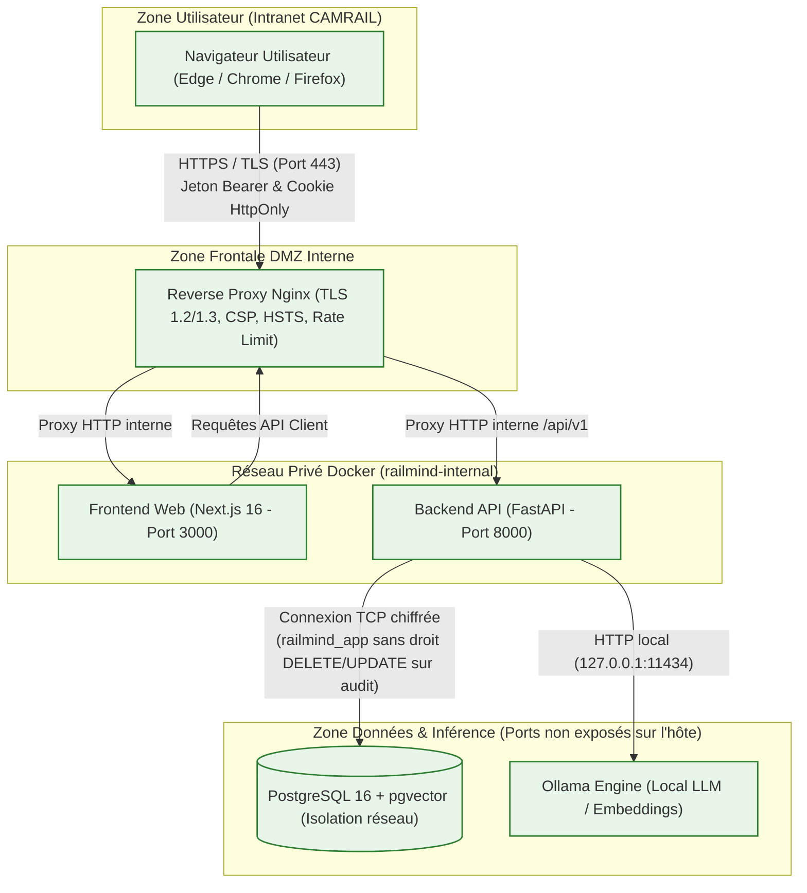

# Politique et Architecture de Sécurité — CAMRAIL RailMind Lite

Ce document présente l'architecture de sécurité, l'analyse des risques (modèle STRIDE), la correspondance avec les standards internationaux (OWASP Top 10 2021 et OWASP Top 10 for LLM Applications 2025), les mesures défensives déployées, les résultats des tests d'abus automatisés, ainsi que les risques résiduels et responsabilités de l'exploitant.

---

## 1. Périmètre et Hypothèses

### 1.1 Périmètre couvert
Le système **CAMRAIL RailMind Lite** est un assistant de recherche documentaire ferroviaire augmenté par génération (RAG) destiné à un usage professionnel interne au sein de CAMRAIL (Cameroun).

- **Composants inclus** :
  - Passerelle inverse HTTPS / TLS (Nginx).
  - Interface utilisateur Web (Next.js 16).
  - API d'administration et moteur RAG (FastAPI / Python 3.12+).
  - Base de données relationnelle et vectorielle (PostgreSQL 16 avec extension pgvector).
  - Serveur d'inférence LLM local (Ollama).
  - Pipeline de traitement et d'indexation de documents (PDF et DOCX).
  - Journal d'audit cryptographiquement scellé (HMAC-SHA256).

### 1.2 Hypothèses d'exploitation
- **Réseau interne souverain** : L'application est exploitée sur l'intranet sécurisé de CAMRAIL ou sur des serveurs sur site (on-premise).
- **IA locale sans exfiltration** : Toutes les inférences LLM et embeddings sont exécutés localement (sur GPU/CPU sur site). Aucun appel d'API vers des fournisseurs cloud publics (OpenAI, Anthropic, Google) n'est autorisé en production.
- **Rôles applicatifs stricts** :
  - `admin` : Administration globale des utilisateurs, sécurité, audit et documents.
  - `document_admin` : Gestion et indexation documentaire, affectation de groupes de sécurité.
  - `read_only` : Consultation documentaire et questions au RAG, cloisonnées par département et groupes de sécurité.

### 1.3 Éléments hors périmètre
- Sécurité physique des salles serveurs et des postes de travail clients.
- Gestion des identités d'entreprise externe (pas de SSO SAML/AD/LDAP natif, authentification locale gérée par l'application).
- Résilience face à un administrateur système hôte malveillant disposant d'un accès `root` physique ou SSH sur la machine hôte.

---

## 2. Architecture de Sécurité et Frontières de Confiance

### 2.1 Schéma d'Architecture (Mermaid)

### 2.2 Frontières de Confiance
1. **Frontière 1 : Navigateur -> Nginx (Frontière Externe Intranet)**
   - Chiffrement TLS obligatoire.
   - En-têtes de sécurité stricts (HSTS, CSP, X-Frame-Options, X-Content-Type-Options).
   - Validation stricte de format et mitigation contre le brute-force par IP.
2. **Frontière 2 : Nginx -> Backend API (Frontière Applicative)**
   - Authentification par jetons JWT signés (HMAC-SHA256, 15 minutes).
   - Refresh token sécurisé dans un cookie `HttpOnly`, `SameSite=Strict`, `Secure`.
   - Contrôle d'accès unifié `can_access_document` sur chaque endpoint.
3. **Frontière 3 : Backend API -> PostgreSQL & Ollama (Frontière Données)**
   - Les ports 5432 (PostgreSQL) et 11434 (Ollama) ne sont **pas publiés sur l'hôte** dans `docker-compose.yml`.
   - Isolation stricte dans le bridge Docker `railmind-network`.
   - Triggers PostgreSQL empêchant l'altération (`UPDATE`, `DELETE`, `TRUNCATE`) du journal d'audit.

---

## 3. Modèle de Menaces STRIDE

| Catégorie STRIDE | Menace Identifiée | Actif Visé | Mesure Défensive en Place | Test Associé | Statut |
| :--- | :--- | :--- | :--- | :--- | :--- |
| **Spoofing** (Usurpation) | Falsification de signature JWT, algorithme `none`, vol de jeton expiré | Session utilisateur / API | Validation cryptographique stricte, rejet de l'alg `none`, claims obligatoires (`iss`, `aud`, `jti`, `exp`), liste de révocation en base. | `test_auth_hardening.py::test_access_token_claims_and_validation` | **Implémenté** |
| **Spoofing** (Usurpation) | Réutilisation frauduleuse d'un refresh token volé | Compte utilisateur | Détection de réutilisation (Refresh Token Reuse Detection) : révocation immédiate de toute la famille de jetons et journalisation d'une alerte critique. | `test_auth_hardening.py::test_refresh_token_lifecycle_and_reuse_detection` | **Implémenté** |
| **Tampering** (Altération) | Modification ou suppression rétroactive d'événements du journal d'audit | Intégrité des journaux (`audit_logs`) | Chaîne de hachage HMAC-SHA256 avec clé dédiée, trigger PostgreSQL interdisant `UPDATE`/`DELETE`/`TRUNCATE`, verrou consultatif `pg_advisory_xact_lock` anti-bifurcation. | `test_audit_chain.py::test_tampering_detection_modification` | **Implémenté** |
| **Tampering** (Altération) | Injection SQL via formulaires ou métadonnées de documents | Base de données PostgreSQL | Utilisation exclusive de l'ORM SQLAlchemy avec requêtes paramétrées ; aucune concaténation SQL brute. | `test_sql_injection.py` | **Implémenté** |
| **Repudiation** (Répudiation) | Déni d'une action administrative ou d'une consultation sensible | Responsabilité des opérations | Journalisation exhaustive avec horodatage UTC déterministe, identifiant acteur, email, adresse IP résolue, type d'entité et action scellée. | `test_audit_chain.py::test_audit_chain_valid_after_n_writes` | **Implémenté** |
| **Information Disclosure** | IDOR : consultation de documents ou conversations d'un autre département | Confidentialité documentaire | Fonction de contrôle d'accès centralisée `can_access_document` vérifiant rôle, département et groupes de sécurité ; réponse uniforme HTTP 404 (pour ne pas divulguer l'existence). | `test_access_matrix.py`, `test_conversation_ownership.py` | **Implémenté** |
| **Information Disclosure** | Fuite de données ou tokens dans les logs et sorties LLM | Secrets, clés et tokens | Masquage récursif automatique des clés `password`, `token`, `secret` dans `audit.py` ; filtre de sortie `output_filter.py` neutralisant URLs et balises d'exfiltration. | `test_token_leakage_and_rate_limit.py`, `test_output_filter_and_hardening.py` | **Implémenté** |
| **Denial of Service** | Force brute sur les identifiants ou inondation de requêtes LLM | Disponibilité du service | Verrouillage de compte après 5 échecs consécutifs (15 min avec `Retry-After`), limitation par IP (20 échecs), limitation de débit des questions (`UserRateLimiter` : 10 req/min). | `test_auth_hardening.py`, `test_token_leakage_and_rate_limit.py` | **Implémenté** |
| **Elevation of Privilege** | Émission d'un jeton avec un rôle `admin` forgé dans le payload | Droits d'administration | Le rôle encodé dans le JWT n'est pas aveuglément cru ; l'utilisateur et son statut actif sont systématiquement rechargés depuis la base de données. | `test_auth_hardening.py::test_access_token_claims_and_validation` | **Implémenté** |

---

## 4. Correspondance OWASP Top 10 (2021) & OWASP LLM Top 10 (2025)

### 4.1 OWASP Top 10 (2021)

| Thème OWASP 2021 | Mesure de Protection Mise en Œuvre | Fichiers Concernés |
| :--- | :--- | :--- |
| **A01:2021 – Broken Access Control** | Contrôle d'accès unifié `can_access_document`, scoping strict des requêtes SQL par utilisateur et département, neutralisation IDOR avec code HTTP 404. | `app/security.py`, `app/routers/documents.py`, `app/routers/assistant.py` |
| **A02:2021 – Cryptographic Failures** | Mots de passe hachés avec `bcrypt` (12 rounds) ; chaîne d'audit sous `HMAC-SHA256` ; transit sous TLS 1.2/1.3 ; interdiction stricte de jetons dans les URLs. | `app/security.py`, `app/services/audit.py`, `deploy/nginx/nginx.conf` |
| **A03:2021 – Injection** | ORM SQLAlchemy avec requêtes paramétrées (neutralisation SQLi) ; neutralisation de traversée de chemin dans `sanitize_filename` ; validation des noms de documents. | `app/routers/documents.py`, `app/routers/auth.py`, `app/routers/assistant.py` |
| **A04:2021 – Insecure Design** | Modèle de menaces STRIDE, limitation de débit multiniveau (IP, utilisateur, concurrency limiter), verrou consultatif PostgreSQL anti-fork sur l'audit. | `app/services/concurrency.py`, `app/services/audit.py` |
| **A05:2021 – Security Misconfiguration** | Ports PostgreSQL (5432) et Ollama (11434) non publiés sur l'hôte ; désactivation automatique des comptes de démo en production ; validation des clés secrètes. | `docker-compose.yml`, `app/config.py`, `app/main.py` |
| **A06:2021 – Vulnerable and Outdated Components** | Analyses automatisées en CI (`pip-audit`, `npm audit`, `bandit`) ; dépendances mises à jour hebdomadairement par `dependabot`. | `.github/workflows/security.yml`, `.github/dependabot.yml` |
| **A07:2021 – Identification and Authentication Failures** | Protection contre le brute-force avec verrouillage temporaire et en-tête `Retry-After` ; temps de réponse constants pour éviter les attaques temporelles (timing attacks). | `app/routers/auth.py`, `app/security.py` |
| **A08:2021 – Software and Data Integrity Failures** | Journal d'audit scellé par chaîne de hachage HMAC-SHA256 avec détection d'altération immédiate ; contrôle de ratio de décompression des archives DOCX (zip bombs). | `app/services/audit.py`, `app/routers/documents.py` |
| **A09:2021 – Security Logging and Monitoring Failures** | Journalisation systématique des échecs d'authentification, verrouillages, révocations, accès refusés, modifications de statut et d'intégrité du journal. | `app/services/audit.py`, `app/routers/dashboard.py` |
| **A10:2021 – Server-Side Request Forgery (SSRF)** | L'application ne réalise aucune requête HTTP sortante vers l'extérieur ; le moteur RAG fonctionne en circuit fermé intranet ; désactivation de toute fonction dictée réseau. | `app/services/generation.py`, `app/services/output_filter.py` |

---

### 4.2 OWASP Top 10 for LLM Applications (Édition 2025)

| Thème OWASP LLM 2025 | Mesure de Protection Mise en Œuvre | Fichiers Concernés |
| :--- | :--- | :--- |
| **LLM01: Prompt Injection** | Séparation stricte entre les instructions système et les données documentaires via des balises de délimitation (`<extrait>`) ; consigne explicite interdisant l'exécution d'instructions contenues dans les documents. | `app/services/generation.py`, `tests/security/test_output_filter_and_hardening.py` |
| **LLM02: Sensitive Information Disclosure** | Filtre de sortie `sanitize_answer` supprimant toute tentative d'exfiltration d'information (URLs, images Markdown vers serveurs externes, tags HTML) ; masquage des secrets dans les logs. | `app/services/output_filter.py`, `app/services/audit.py` |
| **LLM03: Supply Chain Vulnerabilities** | Téléchargement local sécurisé des modèles Hugging Face via script de préparation offline vérifié ; conteneurs épinglés sur versions figées. | `scripts/prepare_models.py`, `docker-compose.yml` |
| **LLM04: Data and Model Poisoning** | Validation stricte des fichiers lors de l'upload (signature `%PDF-`, intégrité structurelle DOCX, rejet des bombes de décompression, doubles extensions dangereuses). | `app/routers/documents.py`, `tests/security/test_upload_hardening.py` |
| **LLM05: Improper Output Handling** | Nettoyage systématique du flux de réponse (mode normal et streaming SSE) via `sanitize_answer` ; encodage strict des caractères spéciaux et interdiction d'exécution HTML dans le navigateur. | `app/services/output_filter.py`, `frontend/camrail-rda/app/assistant/page.tsx` |
| **LLM06: Excessive Agency** | Le LLM n'a aucun accès aux outils système, aucune capacité d'exécution de code (`eval`), ni accès direct à la base de données ; il est cantonné à la reformulation factuelle d'extraits textuels fournis. | `app/services/generation.py` |
| **LLM07: System Prompt Leakage** | Cadrage du prompt pour interdire la répétition des consignes internes et refus des requêtes de type *"Répète tes instructions initiales"*. | `app/services/generation.py` |
| **LLM08: Vector and Embedding Weaknesses** | Isolation des embeddings dans `pgvector` par document et contrôle systématique de la visibilité documentaire (`can_access_document`) avant injection des chunks dans le contexte RAG. | `app/services/retrieval.py`, `app/security.py` |
| **LLM09: Misinformation & Hallucination** | Calcul de score de confiance vectorielle (`vector_distance`) ; abstention automatique explicite si la distance dépasse le seuil calibré ; obligation d'associer chaque affirmation à une citation `[n]`. | `app/services/generation.py` |
| **LLM10: Unbounded Consumption** | Limitation du nombre de requêtes simultanées (`ConcurrencyLimiter` avec file d'attente et timeout) et limitation de débit utilisateur (`UserRateLimiter` 10 req/min). | `app/services/concurrency.py` |

---

## 5. Synthèse des Tests d'Abus Automatisés

Le tableau ci-dessous récapitule les 50 scénarios de tests d'abus exécutés dans `backend/tests/security/` (couverture 100 % passée) :

| Domaine de Menace | Test Automatisé | Scénario d'Abus Vérifié | Résultat Obtenu |
| :--- | :--- | :--- | :--- |
| **Contrôle d'accès (IDOR)** | `test_can_access_document_logic` | Matrice rôle x département x groupe sur la logique métier unifiée. | **SUCCÈS (Conforme)** |
| **Contrôle d'accès (IDOR)** | `test_endpoints_access_matrix` | Tentative d'accès direct par ID à un document d'un autre département (GET /documents/{id} et /file). | **SUCCÈS (404 Not Found)** |
| **Contrôle d'accès (IDOR)** | `test_documents_listing_scoping` | Énumération de la liste des documents : seuls les documents autorisés sont visibles. | **SUCCÈS (Cloisonné)** |
| **Contrôle d'accès (IDOR)** | `test_document_detail_pages_and_idor_matrix` | Consultation des pages internes d'un document non autorisé. | **SUCCÈS (404 Not Found)** |
| **Contrôle d'accès (IDOR)** | `test_citations_and_evidence_scoping` | Recherche RAG : les extraits et citations de documents non autorisés sont exclus du contexte. | **SUCCÈS (Zéro fuite)** |
| **Conversations** | `test_user_cannot_read_others_conversation_messages` | Tentative de lecture des messages de la conversation d'un autre utilisateur. | **SUCCÈS (404 Not Found)** |
| **Conversations** | `test_user_cannot_delete_others_conversation` | Tentative de suppression de la conversation d'un tiers. | **SUCCÈS (404 Not Found)** |
| **Conversations** | `test_user_cannot_append_message_to_others_conversation` | Tentative d'injection d'un message dans la conversation d'un autre utilisateur. | **SUCCÈS (404 Not Found)** |
| **JWT & Authentification** | `test_jwt_secret_validation_production` | Démarrage en production avec un secret faible (< 32 caractères). | **SUCCÈS (Refus de démarrage)** |
| **JWT & Authentification** | `test_access_token_claims_and_validation` | Jeton forgé (alg: none, expiré, mauvais iss/aud, rôle admin usurpé). | **SUCCÈS (401 / Rôle ignoré)** |
| **JWT & Authentification** | `test_refresh_token_lifecycle_and_reuse_detection` | Rejeu d'un refresh token déjà renouvelé (Reuse Detection). | **SUCCÈS (Famille révoquée)** |
| **Force brute & Lockout** | `test_bruteforce_protection_and_timing_mitigation` | 5 échecs de mot de passe consécutifs, timing mitigé, déverrouillage admin. | **SUCCÈS (429 Retry-After)** |
| **Protection Démo** | `test_demo_accounts_production_protection` | Refus d'exécution de seed_demo en production et désactivation des comptes démo. | **SUCCÈS (Désactivés)** |
| **Sécurité des Tokens** | `test_get_file_with_query_param_token_returns_401` | Tentative de téléchargement avec token en paramètre URL `?token=...`. | **SUCCÈS (401 Refusé)** |
| **Sorties LLM (Exfiltration)** | `test_sanitize_answer_markdown_images` | Suppression des images Markdown `` visant l'exfiltration de données. | **SUCCÈS (Supprimé)** |
| **Sorties LLM (Exfiltration)** | `test_sanitize_answer_markdown_links` | Transformation des liens markdown `[texte](url)` en texte brut. | **SUCCÈS (Neutralisé)** |
| **Sorties LLM (Exfiltration)** | `test_sanitize_answer_raw_urls` | Remplacement des URLs brutes par `[lien retiré]`. | **SUCCÈS (Remplacé)** |
| **Sorties LLM (Exfiltration)** | `test_assistant_query_with_llm_exfiltration` | Réponse LLM hostile contenant URLs et images (endpoint synchrone). | **SUCCÈS (Assaini + Audit)** |
| **Sorties LLM (Exfiltration)** | `test_assistant_query_stream_with_llm_exfiltration` | Événement final `done` du flux SSE contenant la réponse nettoyée. | **SUCCÈS (Assaini)** |
| **En-têtes de Sécurité** | `test_security_headers_on_unauthenticated_response` | Présence des en-têtes CSP, HSTS, X-Content-Type-Options, X-Frame-Options. | **SUCCÈS (Conforme)** |
| **Isolation Réseau** | `test_docker_compose_does_not_publish_port_5432` | Vérification de l'absence de publication des ports 5432 et 11434 sur l'hôte. | **SUCCÈS (Ports privés)** |
| **Prompt Injection** | `test_document_prompt_injection_containment` | Document injectant une consigne hostile : réponse bornée aux extraits factuels. | **SUCCÈS (Non exécuté)** |
| **Injections SQL** | `test_sql_injection_in_login` | Payloads SQLi (`' OR 1=1--`, etc.) dans le formulaire d'authentification. | **SUCCÈS (401 / Aucune 500)** |
| **Injections SQL** | `test_sql_injection_in_assistant_query` | Payloads SQLi dans la question posée à l'assistant. | **SUCCÈS (Aucune 500)** |
| **Injections SQL** | `test_sql_injection_in_document_upload` | Payloads SQLi dans les métadonnées et nom de fichier lors de l'upload. | **SUCCÈS (Aucune 500)** |
| **Injections SQL** | `test_sql_injection_in_document_listing_and_detail` | Payloads SQLi dans les paramètres de filtre et IDs de documents. | **SUCCÈS (Aucune 500)** |
| **Fuite de Secrets** | `test_token_not_leaked_in_audit_and_logs` | Absence du JWT ou refresh token dans les logs applicatifs et l'audit SQL. | **SUCCÈS (Zéro fuite)** |
| **Limitation de Débit** | `test_question_rate_limiting_429` | Envoi rapide de questions dépassant le quota : renvoi d'une erreur HTTP 429. | **SUCCÈS (429 Déclenché)** |
| **Limitation par IP** | `test_ip_based_rate_limiting_on_login` | Tentatives répétées d'échecs de connexion depuis la même IP. | **SUCCÈS (429 Bloqué)** |
| **Upload Sécurisé** | `test_sanitize_filename_neutralizes_path_traversal` | Fichier avec traversée de répertoire (`../../x.pdf`, caractères de contrôle). | **SUCCÈS (Normalisé)** |
| **Upload Sécurisé** | `test_reject_fake_pdf` | Fichier texte renommé en .pdf sans signature `%PDF-`. | **SUCCÈS (400 Rejeté)** |
| **Upload Sécurisé** | `test_reject_docx_without_document_xml` | Fichier DOCX corrompu ou sans `word/document.xml`. | **SUCCÈS (400 Rejeté)** |
| **Upload Sécurisé** | `test_reject_decompression_bomb` | Archive DOCX zip bomb avec ratio de décompression anormalement élevé (> 100). | **SUCCÈS (400 Rejeté)** |
| **Upload Sécurisé** | `test_reject_oversized_file` | Fichier dépassant la taille maximale autorisée (`MAX_UPLOAD_MB`). | **SUCCÈS (400 Rejeté)** |
| **Upload Sécurisé** | `test_reject_dangerous_double_extension` | Fichier avec double extension exécutable (`payload.exe.pdf`, `.php.pdf`). | **SUCCÈS (400 Rejeté)** |
| **Upload Sécurisé** | `test_read_only_user_cannot_upload` | Utilisateur en lecture seule tentant d'uploader un document. | **SUCCÈS (403 Forbidden)** |
| **Intégrité Journal** | `test_audit_chain_valid_after_n_writes` | Validité cryptographique de la chaîne HMAC après écritures séquentielles. | **SUCCÈS (Chaîne intacte)** |
| **Intégrité Journal** | `test_tampering_detection_modification` | Détection immédiate d'une modification de contenu avec identification de `seq`. | **SUCCÈS (Altération détectée)** |
| **Intégrité Journal** | `test_tampering_detection_deletion` | Détection d'une suppression de ligne dans l'historique d'audit. | **SUCCÈS (Rupture détectée)** |
| **Intégrité Journal** | `test_tampering_detection_insertion_in_middle` | Détection d'une tentative d'insertion rétroactive au milieu de la chaîne. | **SUCCÈS (Rupture détectée)** |
| **Intégrité Journal** | `test_concurrent_writes_20_threads_no_gaps_valid_chain` | 20 threads concurrents écrivant simultanément via verrou PostgreSQL. | **SUCCÈS (Zéro trou ni fork)** |
| **Intégrité Journal** | `test_database_trigger_refuses_update_and_delete` | Rejet des requêtes SQL `UPDATE`, `DELETE`, `TRUNCATE` par trigger de base. | **SUCCÈS (Exception SQL levée)** |
| **Intégrité Journal** | `test_sensitive_data_masking_in_details` | Masquage récursif automatique des mots de passe et secrets dans `details_json`. | **SUCCÈS (Masqué)** |
| **Intégrité Journal** | `test_dashboard_verify_endpoint` | Endpoint d'administration `GET /dashboard/audit/verify` et événement tracé. | **SUCCÈS (Conforme)** |

---

## 6. Risques Résiduels (Analyse Honnête et Factuelle)

Conformément à une démarche d'ingénierie de sécurité rigoureuse, les risques résiduels suivants sont acceptés ou documentés pour l'exploitant :

1. **Jeton d'accès dans `sessionStorage`** :
   - *Description* : Le jeton d'accès (access token) est stocké dans le `sessionStorage` du navigateur pour autoriser les requêtes API asynchrones côté client.
   - *Risque* : En cas d'introduction d'une faille XSS majeure dans l'application, ce jeton pourrait être extrait par un script injecté.
   - *Mitigation* : Le jeton expire rapidement (15 minutes). Le refresh token, quant à lui, est protégé dans un cookie `HttpOnly` inaccessible en JavaScript.
2. **Politique CSP avec directive `'unsafe-inline'`** :
   - *Description* : La politique de sécurité du contenu (CSP) autorise `'unsafe-inline'` pour certains styles CSS indispensables au rendu réactif de TailwindCSS et Next.js.
   - *Risque* : Réduction de l'efficacité de la CSP contre les attaques par injection de style.
   - *Mitigation* : Les scripts inline restent strictement restreints (`'unsafe-eval'` est interdit en production), et les filtres de sortie éliminent les balises HTML.
3. **Absence de détection d'injection sémantique lors de l'upload des documents** :
   - *Description* : Les fichiers PDF et DOCX téléversés sont vérifiés structurellement (taille, en-tête, absence de bombe zip), mais le texte extrait n'est pas scanné par un classificateur NLP d'injection au moment de l'indexation.
   - *Risque* : Un document légitime contenant une tentative d'injection indirecte (ex: *"Ignore les consignes précédentes"*) sera indexé.
   - *Mitigation* : C'est le cadrage strict du prompt RAG avec délimiteurs de données qui neutralise l'exécution lors de la phase de réponse.
4. **Absence de filigrane dynamique sur les visualisations** :
   - *Description* : Les documents consultés ou téléchargés ne portent pas de filigrane dynamique personnalisé (ex: nom et matricule de l'utilisateur qui consulte).
   - *Risque* : Risque de fuite par capture d'écran non traçable visuellement par l'exploitant.
5. **Extraction documentaire sans bac à sable (Sandbox)** :
   - *Description* : Le traitement PDF (pypdfium2 / pdfplumber) et DOCX (python-docx) s'exécute dans le conteneur backend sans isolation renforcée (pas de bac à sable gVisor/seccomp dédié ni de délai d'expiration strict par page).
   - *Risque* : Une vulnérabilité critique non corrigée dans les bibliothèques C sous-jacentes (ex: libpdfium) pourrait impacter le conteneur backend.
   - *Mitigation* : Les utilisateurs pouvant uploader sont limités aux seuls rôles `admin` et `document_admin`.
6. **Verrouillage de compte exploitable pour déni de service ciblé** :
   - *Description* : Un attaquant connaissant l'adresse email d'un collègue peut volontairement saisir 5 mauvais mots de passe pour verrouiller son compte pendant 15 minutes.
   - *Mitigation* : Seul l'administrateur peut déverrouiller immédiatement via l'interface `POST /users/{id}/unlock`.
7. **Contournement des triggers PostgreSQL par le superutilisateur** :
   - *Description* : Le propriétaire de la base (`postgres` / superuser) peut désactiver les triggers (`DISABLE TRIGGER`) ou altérer directement les enregistrements.
   - *Mitigation* : C'est la **vérification cryptographique de la chaîne HMAC-SHA256** qui détecte avec certitude absolue toute modification ou suppression non autorisée.
8. **Serveur Ollama sans authentification sur le réseau interne** :
   - *Description* : L'instance Ollama n'exige pas de jeton d'authentification pour accepter des requêtes sur son port 11434.
   - *Mitigation* : Le port 11434 est strictement confiné au réseau privé interne Docker et n'est jamais exposé à l'extérieur ni publié sur l'hôte.
9. **Absence de signature cryptographique sur les modèles d'IA** :
   - *Description* : Les poids des modèles GGUF ou Hugging Face sont téléchargés lors de la phase d'initialisation sans validation par signature PKI matérielle.
   - *Mitigation* : Les empreintes SHA-256 des fichiers modèles doivent être vérifiées par l'administrateur lors de l'approvisionnement initial.
10. **Absence d'authentification multifacteur (MFA / 2FA)** :
    - *Description* : L'authentification locale actuelle repose sur le couple identifiant / mot de passe fort.
    - *Mitigation* : Les règles de complexité de mot de passe sont renforcées et le brute-force est mitigé.

---

## 7. Responsabilités de l'Exploitant CAMRAIL

Pour garantir le niveau de sécurité opérationnel du système, l'équipe d'exploitation CAMRAIL doit obligatoirement respecter les directives suivantes :

1. **Certificats TLS d'entreprise** : Remplacer les certificats auto-signés de test par des certificats valides émis par l'autorité de certification interne de CAMRAIL ou une autorité publique reconnue.
2. **Sauvegardes chiffrées régulières** : Mettre en place une tâche planifiée quotidienne de sauvegarde de la base de données PostgreSQL (`pg_dump`) et du répertoire `storage/documents`, chiffrée avec GPG ou AES-256.
3. **Rotation des secrets** : Effectuer une rotation annuelle (ou en cas de suspicion de compromission) des clés secrètes `JWT_SECRET` et `AUDIT_HMAC_KEY` dans le fichier `.env` de production.
4. **Surveillance périodique du journal d'audit** :
   - Configurer le script `scripts/verify_audit_chain.py` dans le planificateur de tâches (cron ou Windows Task Scheduler) pour s'exécuter chaque nuit.
   - Configurer une alerte mail / SNMP en cas de code de sortie différent de 0.
5. **Mises à jour de sécurité de l'hôte** : Appliquer régulièrement les correctifs de sécurité sur le système d'exploitation hôte (Linux Debian/Ubuntu ou Windows Server) et sur le moteur Docker.

---

## 8. Procédure de Signalement de Vulnérabilité

Si vous découvrez une vulnérabilité de sécurité ou un comportement anormal dans **CAMRAIL RailMind Lite**, merci de ne pas ouvrir de ticket public.

- **Point de contact sécurité** : `securite-informatique@camrail.net`
- **Délai de prise en charge** : L'équipe de sécurité s'engage à accuser réception sous 48 heures ouvrées et à fournir un correctif qualifié sous 14 jours.
- **Informations requises** :
  - Description détaillée de la vulnérabilité.
  - Étapes de reproduction ou script de démonstration (PoC).
  - Version du logiciel et environnement de déploiement concerné.

---

## 9. Historique des Versions du Document

| Version | Date | Auteur | Modifications principales |
| :--- | :--- | :--- | :--- |
| **1.0.0** | 18/10/2026 | Antigravity AI Security Team / CAMRAIL | Version initiale complète : architecture, STRIDE, correspondances OWASP Top 10 & LLM 2025, rapport des 50 tests d'abus et risques résiduels. |
